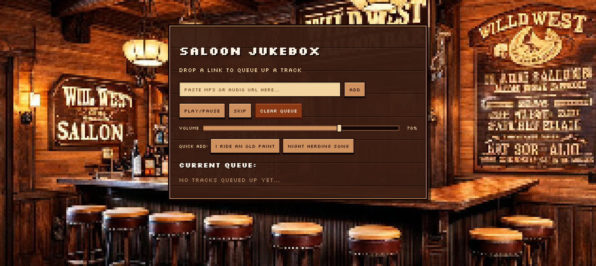

# saloon jukebox

a simple, cozy web jukebox built for queuing and streaming audio links. created for the **hack club pixl challenge**.

## how it works

the app uses vanilla javascript and the standard html5 audio api to handle track playback without external libraries. 

- **queue management:** paste any direct audio link (like an .mp3 file) into the input box and hit add. the app parses the file name directly from the url. if the filename is missing or too long, it automatically assigns a track number.
- **audio controls:** full control over your queue including play/pause toggles, track skipping, and a full queue clear.
- **automatic transitions:** tracks transition automatically to the next song in line using js onended event handlers.
- **quick presets:** built-in shortcut buttons let you instantly queue up cowboy classics like *i ride an old paint* and *night herding song*.
- **visual feedback:** the queue ui dynamically re-renders whenever tracks are added or played, highlighting the currently active track in green.

## project layout

- `index.html` - the core structure, player controls, and preset buttons.
- `script.js` - the queue state logic, event listeners, and html5 audio player management.
- `style.css` - custom styling featuring an ai-generated saloon background.
- `/media/` - holds default audio tracks, demo images, and favicons.

## running locally

no dependencies, npm packages, or build processes required. just clone the repository and open `index.html` in your browser.
