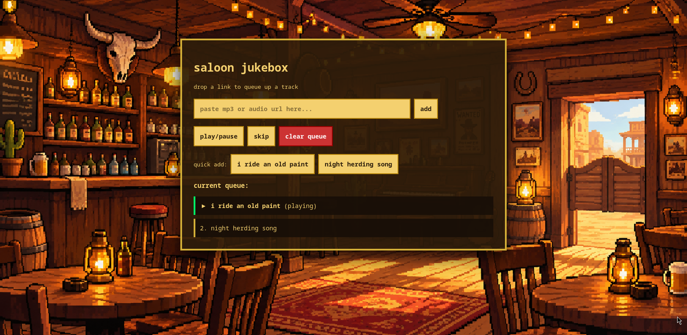

# saloon jukebox

a web jukebox built for queuing and playing audio stream links. created for the hack club pixl challenge.

## features
- can play mp3 links
- html5 audio playback controls (play, pause, skip, clear queue)
- cozy ui (that background is ai generated)

## running locally
clone the repo and open `index.html` directly in your browser.

